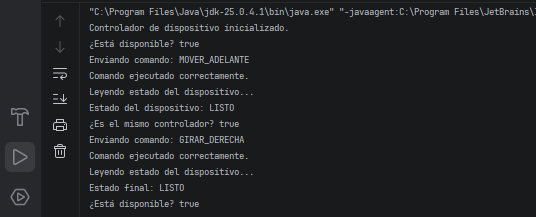

# Ejercicio 5: Administrador de Dispositivos de Hardware Únicos

## Descripción

Este ejercicio implementa el patrón de diseño **Singleton** en Java para controlar el acceso a un recurso de hardware exclusivo, representado mediante un dispositivo simulado.

La clase `DeviceController` centraliza el envío de comandos, la consulta del estado operacional y la comprobación de disponibilidad del dispositivo.

## Objetivos

- Aplicar Singleton para administrar un recurso compartido y exclusivo.
- Impedir la creación de instancias adicionales mediante un constructor privado.
- Garantizar que todos los componentes obtengan la misma referencia del controlador.
- Simular el envío de comandos y la lectura del estado del dispositivo.
- Verificar la disponibilidad antes de procesar instrucciones.
- Sincronizar el acceso a las operaciones del controlador.

## Implementación del patrón Singleton

La clase `DeviceController` utiliza los siguientes elementos:

- **Instancia estática:** mantiene la referencia al único controlador.
- **Constructor privado:** impide crear instancias directamente desde otras clases.
- **Método `getInstance()`:** crea el controlador cuando se solicita por primera vez y devuelve siempre la misma instancia.
- **Método `sendCommand()`:** simula el envío de instrucciones al dispositivo.
- **Método `readStatus()`:** permite consultar el estado operacional.
- **Método `isAvailable()`:** indica si el dispositivo está disponible.
- **Métodos sincronizados:** coordinan el acceso concurrente a la instancia y a las operaciones del dispositivo.

La instancia se crea de forma perezosa (*Lazy Initialization*), es decir, únicamente cuando se solicita por primera vez.

## Propósito de la clase DeviceController

La clase `DeviceController` se creó para centralizar la comunicación con un dispositivo de hardware que debe tener un único punto de control. 
Si diferentes componentes administraran controladores independientes, podrían producirse conflictos al enviar instrucciones al mismo recurso físico.

En este ejercicio, tanto el dispositivo como el envío de comandos son simulados mediante mensajes en la consola y un estado interno. No se establece una conexión física real con un puerto serial.

## Concepto clave
En este ejercicio usamos synchronized para coordinar el acceso al controlador. Como sendCommand() es sincronizado, dos hilos que llamen a ese método sobre la misma instancia no podrán ejecutar simultáneamente el cuerpo del método.
## Resultado

## Conclusión

Este ejercicio demuestra cómo Singleton permite centralizar el control de un recurso exclusivo y garantizar que todos los componentes utilicen la misma instancia.

El constructor privado impide crear controladores directamente, mientras que `getInstance()` proporciona el acceso compartido. La sincronización coordina las operaciones que acceden al estado del dispositivo.